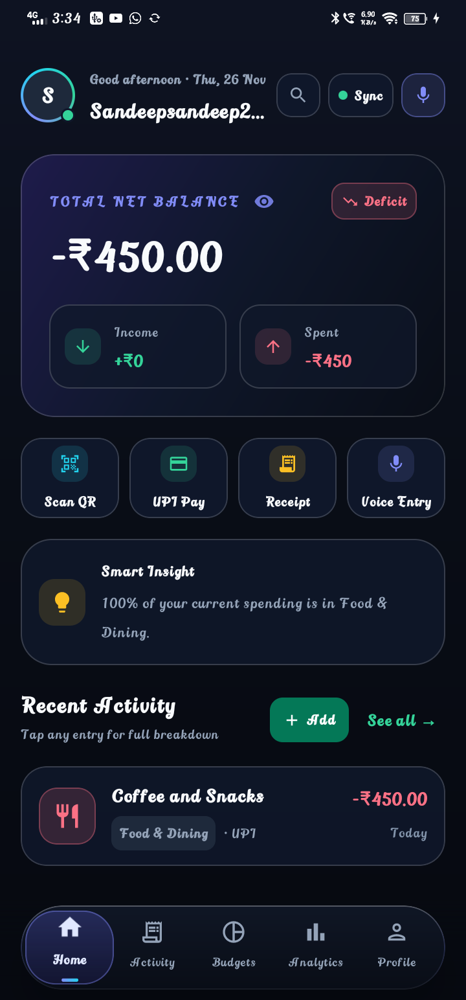
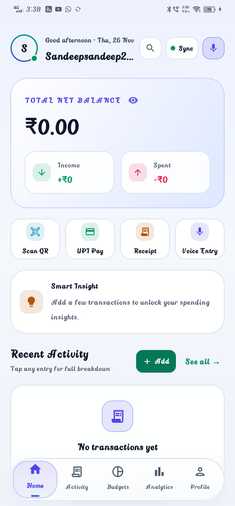
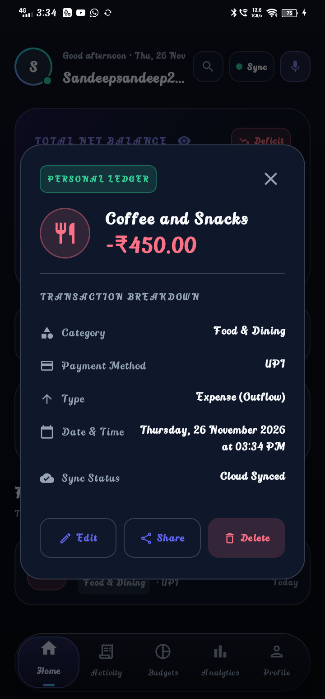
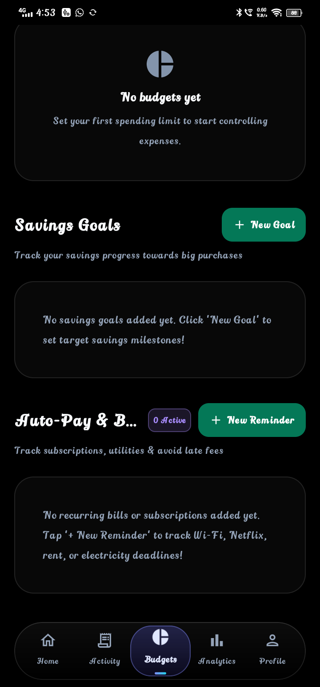
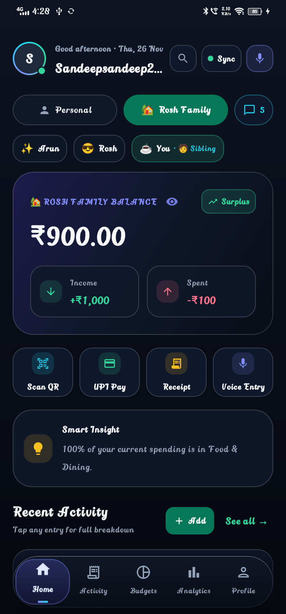
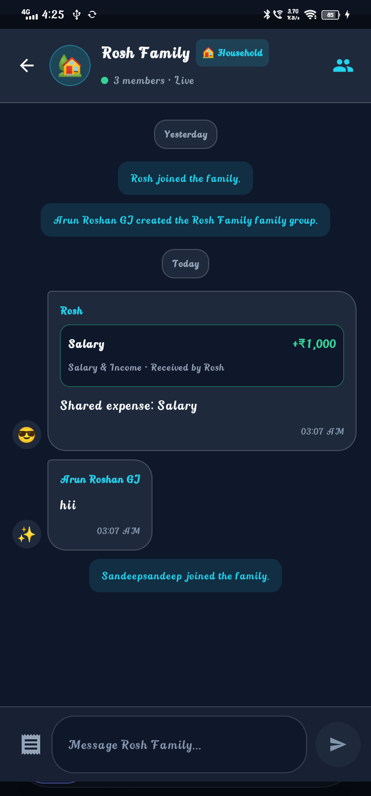
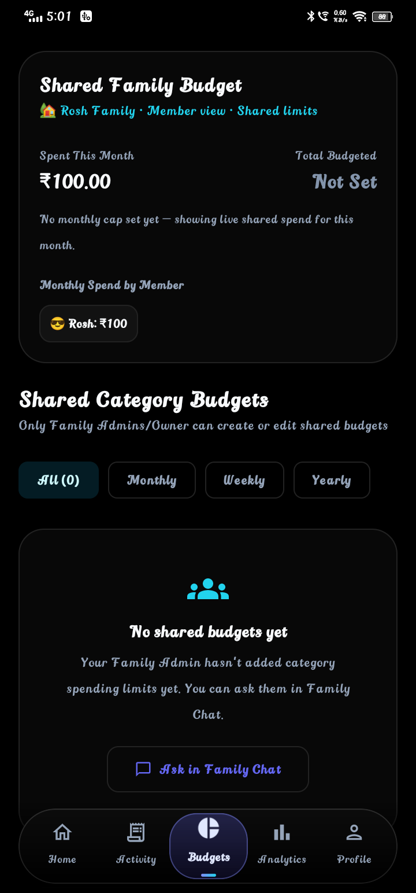
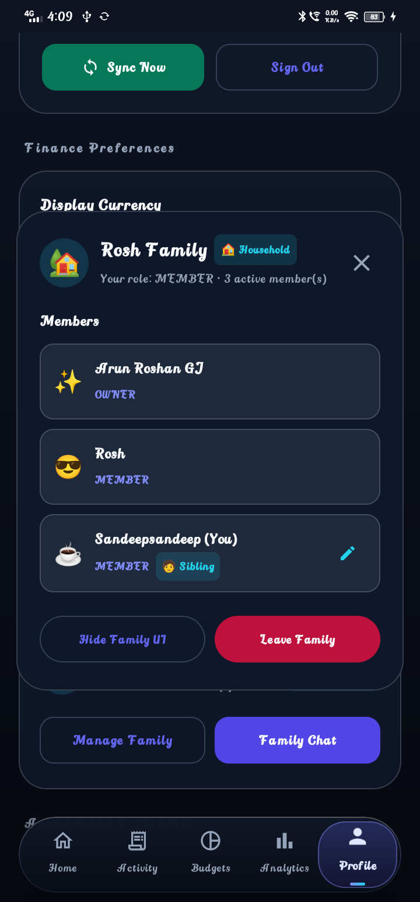

# Zenith v2.0 — Personal & Family Expense Tracker

Zenith is a modern Android personal & shared-family finance application (`com.zenith.app`) built with **Kotlin**, **Jetpack Compose (Material 3)**, **Room**, **Supabase**, **CameraX + ML Kit**, **ZXing**, and **Gemini AI**. It combines an offline-first personal ledger and shared multi-member family workspace with direct UPI app redirection, on-device UPI payment auto-detection, QR invite joining, real-time family chat, receipt OCR, voice logging, budgets, savings goals, and multi-format reporting.

> **Latest Release:** [`Zenith v2.0`](https://github.com/roshzxn/zenith-app/releases/tag/v2.0) (`Zenith-v2.0.apk`)

---

## Screenshots

### Personal Finance & Adaptive Themes

<table>
  <tr>
    <td align="center"><b>Home Dashboard (Dark)</b></td>
    <td align="center"><b>Crisp Light Theme</b></td>
    <td align="center"><b>Transaction Breakdown</b></td>
    <td align="center"><b>Budgets, Goals & Auto-Pay</b></td>
  </tr>
  <tr>
    <td></td>
    <td></td>
    <td></td>
    <td></td>
  </tr>
</table>

### Shared Family Mode & Collaboration (v2.0)

<table>
  <tr>
    <td align="center"><b>Family Dashboard</b></td>
    <td align="center"><b>Family Group Chat</b></td>
    <td align="center"><b>Shared Family Budgets</b></td>
    <td align="center"><b>Manage Family & Roles</b></td>
  </tr>
  <tr>
    <td></td>
    <td></td>
    <td></td>
    <td></td>
  </tr>
</table>

---

## Key Features

### Personal Ledger & Activity Explorer
- **Home Dashboard**: Live net balance ticker with rolling digit odometer (`RollingCounterText`), income/spent cards, privacy balance masking, and quick entry shortcuts (`Scan & Pay`, `UPI Pay`, `Receipt`, `Voice Entry`), plus a Home Screen summary widget (`ZenithSummaryWidgetProvider`).
- **Unified Activity Feed**: Single smooth-scrolling feed with instant keyword search, transaction type toggles, date-range filters (`All Time`, `Today`, `This Week`, `This Month`), category chips, daily grouped cards, detailed modal editor (`TransactionDetailModal`), and Undo delete support.

### Shared Family Expense Tracking (`v2.0`)
- **Workspace Switcher & Strict Isolation**: Toggle seamlessly between `Personal` and `Family` ledgers right from Home (`FamilyRepository`, `FinancialContext`), keeping Personal Savings Goals and Auto-Pay isolated from shared family expenses.
- **1-Tap Invite QR Codes, Gallery Scan & Role Controls**: Generate and cache shareable `zenith://join` QR invites (`FamilyQrComponents`), scan from live camera or gallery photos via ML Kit (`FamilyInviteQrScannerDialog`) to join with a 1-tap banner, assign `OWNER` / `ADMIN` / `MEMBER` permissions, and customize family labels, member tags, and avatars (`FamilyManagementModals`).
- **Real-Time Family Chat (`FamilyChatSheet`)**: Edge-to-edge group chat with a floating frosted-glass capsule composer that tracks keyboard/navigation insets cleanly, transaction attachment picker, live message sync, and quick budget requests from the Budgets tab.
- **Shared Family Budgets (`BudgetsAndGoalsScreen`)**: Role-gated shared spending limits with live monthly family spend tracking, per-member spend breakdown chips, and double-counting protection across `Overall` + category caps.

### UPI Payments & On-Device Auto-Tracking
- **Direct UPI App Redirect (`UpiQrScanModal`, `UPIPaySheet`)**: Tapping **Scan & Pay** immediately opens your saved default UPI app or Android's system `upi://pay` chooser (Google Pay, PhonePe, Paytm, BHIM, CRED, Amazon Pay, WhatsApp Pay, MobiKwik, Navi, Freecharge, super.money), copies recipient details when paying directly, and auto-prompts a confirmation/log sheet upon returning to Zenith (`ON_RESUME`).
- **On-Device Notification Listener (`UpiNotificationListenerService`)**: Parses debit/credit alerts 100% on-device across major Indian UPI apps and banking apps to extract amount, payee name, VPA, and 12-digit UTR with 1-tap notification shade logging and automatic deduplication (`UpiPaymentBus`, `NotificationExpenseActionReceiver`).
- **Strict State & Security Validation (`UpiService`)**: Separates `SUCCESSFUL`, `PENDING`, `FAILED` (including bank/PSP security declines), `CANCELLED`, and `INITIATED` outcomes so declined, failed, or cancelled attempts cannot be saved as settled expenses. Includes a [`UpiGatewayVerifier`](app/src/main/java/com/zenith/app/data/upi/UpiService.kt) contract so gateway orders require authenticated server-side / webhook verification before settlement.

### AI & Smart Automation
- **Voice Expense Assistant (`VoiceAiModal`)**: Speak natural commands (e.g., *"Spent 250 on biryani via UPI"*) processed via speech recognition and `GeminiAiService`.
- **Receipt Scanner (`ReceiptScanModal`)**: Capture or pick receipt images for on-device ML Kit OCR + itemized extraction (`ScannedItemEntity`) attached directly to transactions.
- **Financial Coach (`AnalyticsScreen`)**: Period comparisons (`This Month`, `7 Days`, `30 Days`, `All Time`), Income vs. Expenses flow chart, category breakdown donut chart, payment method breakdown, and AI-powered or local data-driven insights.

### Planning, Security & Backups
- **Budgets, Savings Goals & Auto-Pay (`BudgetsAndGoalsScreen`)**: Monthly/weekly/custom category limits, progress tracking, goal fund deposits, and recurring bill/subscription reminders (`AutoPayReminderDao`).
- **Adaptive 3-Mode Theme**: **Crisp Light**, **Obsidian Navy Dark**, and **OLED Pure Black (`#000000`)** with accessible contrast tokens (`Color.kt`, `Theme.kt`).
- **Cloud Sync & Offline Vault**: Full guest offline mode via Room (`v19`), plus Supabase Auth, Postgrest sync, and Realtime updates (`SyncEngine`, `supabase/schema.sql`).
- **Data Export & Restore (`ExportImportService`)**: Export filtered reports to **PDF, Excel, CSV, or JSON**, import statements, and restore full JSON vault snapshots (`BackupRestoreModal`).
- **Biometric / PIN App Lock**: Optional device authentication gate (`USE_BIOMETRIC`).

---

## Tech Stack

| Layer | Technology |
|---|---|
| **Language & Build** | Kotlin `2.2.10`, Android Gradle Plugin `9.1.1`, KSP `2.3.5` |
| **UI** | Jetpack Compose (`BOM 2024.09.00`), Material 3, Navigation Compose |
| **Local Storage** | Room `2.7.0` (`CashFlowDatabase`), SharedPreferences |
| **Cloud Backend** | Supabase (`postgrest-kt`, `auth-kt`, `realtime-kt` `3.0.1`), Ktor `3.0.0` |
| **Camera & ML** | AndroidX CameraX `1.5.0`, ML Kit Barcode Scanning `17.3.0` & Text Recognition `16.0.1`, ZXing `3.5.3` |
| **AI Integration** | Gemini API (`GeminiAiService`) |
| **Testing** | JUnit 4, Robolectric `4.16.1`, Compose UI Test, Kotlinx Coroutines Test `1.10.2` (166 unit tests) |

- **Android SDK**: `minSdk = 24`, `targetSdk = 36`, `compileSdk = 36`

---

## Project Structure

```text
zenith-app/
├── app/src/main/
│   ├── AndroidManifest.xml                  # Permissions, deep links (zenith://join), UPI visibility, services & widget
│   └── java/com/zenith/app/
│       ├── MainActivity.kt                  # App shell, Crossfade + saved tab state, auth lock, modals
│       ├── ZenithApplication.kt
│       ├── data/
│       │   ├── ai/GeminiAiService.kt        # Voice, OCR & financial coaching prompts
│       │   ├── dao/                         # CashFlowDao, FamilyDao, AutoPayReminderDao, UserProfileDao
│       │   ├── database/CashFlowDatabase.kt # Room schema, migrations & category seeding
│       │   ├── export/ExportImportService.kt# PDF, Excel, CSV & JSON import/export engine
│       │   ├── models/                      # TransactionEntity, Family*Entity, BudgetEntity, SavingsGoalEntity
│       │   ├── network/                     # SupabaseAuthService, FamilySupabaseClient, Realtime, SyncEngine
│       │   ├── repository/                  # CashFlowRepository, FamilyRepository, ScopedMappers
│       │   ├── upi/                         # UpiService, UpiPaymentBus, NotificationListener & Parser
│       │   └── util/                        # CategoryIconHelper, DateTimeUtils
│       ├── domain/                          # FinancialContext, FamilyRole, workspace isolation models
│       ├── ui/
│       │   ├── components/                  # FamilyChatSheet, FamilyManagementModals, FamilyQrComponents, UPIPaySheet
│       │   ├── screens/                     # Home, Transactions (Activity), Budgets, Analytics, Profile, Auth
│       │   ├── theme/                       # Color tokens, 3-mode ZenithTheme, Typography
│       │   └── viewmodel/CashFlowViewModel.kt
│       └── widget/ZenithSummaryWidgetProvider.kt
├── app/src/test/java/com/zenith/app/        # 166 unit & Robolectric Compose tests
├── docs/screenshots/                        # Curated app screenshots for README showcase
├── supabase/                                # schema.sql & migrations (002_family_mode, 003_delete_and_clear_fix)
├── build.gradle.kts / settings.gradle.kts
└── .env.example                             # Environment variables template
```

---

## Getting Started

### 1. Prerequisites
- Android Studio (supporting AGP `9.1.1` / Kotlin `2.2.10`) or CLI with **JDK 21** and **Android SDK 36**.

### 2. Configure Environment Secrets
Create a `.env` file in the project root from `.env.example` (never commit `.env`):

```properties
GEMINI_API_KEY=your_api_key_here
SUPABASE_URL=https://your-project-id.supabase.co
SUPABASE_ANON_KEY=your_supabase_anon_key_here
```

- Zenith also supports **Offline Vault Mode** without Supabase credentials, and falls back gracefully on-device if cloud or AI keys are absent.

### 3. Configure Supabase Backend (Optional)
To enable cloud sync across sessions:
1. Create a Supabase project.
2. Execute [`supabase/schema.sql`](supabase/schema.sql) in the Supabase SQL Editor to create tables, columns, triggers, strict owner-isolated RLS policies, and Realtime publications.

### 4. Build & Run Tests

```bash
# Run all local JVM & Robolectric Compose unit tests
./gradlew testDebugUnitTest

# Build debug APK
./gradlew assembleDebug
```

---

## Payment Privacy & NPCI Compliance Notes

- Zenith **never requests, collects, or stores UPI PINs, OTPs, or banking passwords**.
- All UPI notification parsing runs **100% on-device**; non-transactional notifications (OTPs, login alerts, promotional messages) are ignored immediately.
- Under NPCI / PSP intent security policies in India, third-party unsigned P2P `upi://pay` intents can be declined by consumer UPI apps (such as Google Pay or PhonePe). Zenith prevents dead ends by offering a **1-tap direct UPI app redirect + clipboard payee copy** alongside Notification Access auto-tracking, while validating returned response codes before allowing any ledger entry.
