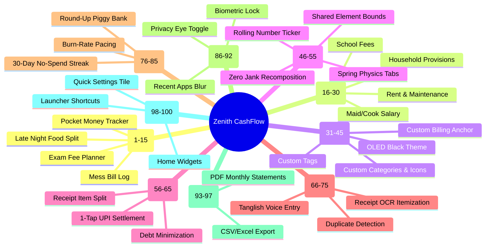

# Top 100 Features Catalog for Student Expense & Family Finance

A comprehensive blueprint tailored specifically for **Student Campus Life**, **Family Household Finance**, **Hyper-Customizability**, and **120 FPS Lag-Free Motion Design**.

---

---

## Pillar 1: Hostel, Mess & Campus Student Life (Features 1–15)

1. **Daily Pocket Money Allowance Pacer**: Divides monthly allowance by remaining days to show exactly how much a student can spend today without running dry before the month ends.
2. **Mess Bill & Daily Meal Attendance Tracker**: Log daily mess cuts, skipped meals, and calculate accurate end-of-month mess rebates.
3. **Chai & Canteen Quick-Tap Counter**: Single-tap counter (+₹10, +₹15, +₹20) for daily campus tea, coffee, and snacks without typing.
4. **Semester & Exam Fee Installment Planner**: Set target deadlines for semester registration and tuition fees with visual countdowns.
5. **Roommate Shared Groceries & Utilities Split**: Split hostel provisions, WiFi recharge, room cleaning, and water can charges evenly or unequally.
6. **Late-Night Delivery Split Calculator**: Automatically splits midnight Swiggy/Zomato delivery charges, taxes, and discounts accurately among hostel mates.
7. **Student Discount & Coupon Bookmark Directory**: Save student discount codes (Spotify, GitHub, Amazon Prime, Apple Student) and track renewal dates.
8. **Semester Textbook Buy/Sell Ledger**: Track money spent on books and record income when reselling them to juniors.
9. **College Project Supplies & Printout Fund**: Separate budget category specifically for lab supplies, printouts, binding, and thesis submissions.
10. **Part-time Job, Internship & Freelance Stipend Tracker**: Track expected vs received stipend dates and client payouts.
11. **Bus / Metro / Train Pass Renewal Reminder**: Countdown notification 3 days before student travel pass expires.
12. **Weekend Trip / Movie Outing Pool**: Shared kitty where friends chip in for weekend road trips, movie tickets, or parties.
13. **Emergency "Broke Mode" Toggle**: Locks non-essential logging and displays only survival food and travel categories when funds drop below ₹500.
14. **Campus Borrow/Lend Tracker**: "Lent ₹200 to Rahul for canteen" with 1-tap WhatsApp nudge reminder.
15. **Overdraft & Zero-Balance Warning**: In-app alert when daily burn rate will deplete the student's account before allowance day.

---

## Pillar 2: Family Vault, Joint Accounts & Household (Features 16–30)

16. **Unified Household Provisions & Maligai Ledger**: Centralized grocery list tracking staple expenses (rice, oil, spices, vegetables).
17. **Domestic Helper / Maid / Cook Salary Tracker**: Log monthly pay, advance payments, and festival bonus/bakshish with date timestamps.
18. **Home Rent & Maintenance Tracker**: Upload rent receipts, landlord bank details, and track monthly apartment maintenance charges.
19. **Child School & College Fee Milestones**: Track quarterly tuition fees, uniforms, van fees, and extracurricular expenses per child.
20. **Medical & Elder Care Prescription Fund**: Tag recurring monthly pharmacy bills, diagnostic tests, and doctor visits for elderly parents.
21. **LPG Gas Cylinder Refill & Subsidy Log**: Record cylinder booking dates, delivery charges, and government subsidy credit.
22. **Electricity & Water Utility Historical Log**: Record units consumed (kWh) and bill amounts to visualize seasonal consumption spikes (e.g. AC in summer).
23. **Joint Festival & Vacation Savings Kitty**: Joint pool for Diwali, Pongal, Eid, or annual family vacation with family progress bars.
24. **Individual Family Member Spending Quotas**: Set monthly soft limits for individual members (e.g. Spouse, Children, Parents).
25. **Kids' Chore & Reward Allowance Ledger**: Reward children for completed tasks/grades with virtual pocket money credit.
26. **Emergency Home Repair Reserve**: Dedicated reserve for unexpected plumbing, electrical, and appliance breakdown costs.
27. **Family Gold & Sovereign Jewelry Inventory**: Track purchase dates, gold weight (grams), hallmark status, and locker location.
28. **Vehicle Insurance, Pollution (PUC) & Service Renewal Alert**: Expiry countdowns for car and two-wheeler insurance policies and fitness certificates.
29. **1-Tap WhatsApp Family Expense Summary**: Formats and shares a clean monthly summary to the family WhatsApp group.
30. **Family Vault Role Permissions**: Define roles (Admin can edit/delete, Member can add, Child/Viewer can only view balances).

---

## Pillar 3: Hyper-Customizability & Theming (Features 31–45)

31. **Custom Category Creator**: Add unlimited custom categories with a library of 100+ fintech icons and custom HEX color picker.
32. **Custom Tag System**: Tag any transaction with multiple hashtags (`#Hostel`, `#GoaTrip`, `#Swiggy`, `#DiwaliShopping`).
33. **Custom Billing Anchor Day**: Set budget month start to any day (e.g. 1st, 5th, 10th, or 25th when salary or pocket money arrives).
34. **Multiple Display Themes**:
    - **Obsidian Dark (Default)**: Deep obsidian navy with specular glassmorphism.
    - **OLED Pure Black**: Battery-saving #000000 true black for AMOLED screens.
    - **Cyber Emerald**: High-contrast futuristic neon green and carbon.
    - **Clean Minimalist Light**: High-legibility crisp white and slate.
35. **Customizable Home Screen Widgets**: Drag and reorder cards on the home screen (put Quick Actions, Net Balance, or Budgets first).
36. **Custom Quick Deposit / Expense Chips**: Configure your own fast amount buttons (+₹50, +₹100, +₹500, +₹2,000).
37. **Multi-Currency Support**: Switch display between INR (₹), USD ($), EUR (€), GBP (£), AED, and SGD.
38. **Custom Notes with Photo & Receipt Attachments**: Attach photos of paper bills or product labels directly to transactions.
39. **Custom Audio & Haptic Feedback Profiles**: Select custom click sounds or haptic intensities (Light, Crisp, Medium, Heavy, Off).
40. **Automatic Theme Switcher**: Automatically toggle between light/dark themes according to sunrise/sunset or system setting.
41. **Customizable Typography Scale**: Choose font sizes (Compact, Standard, Large) and font families (JetBrains Mono, Inter, Plus Jakarta).
42. **Whole Number / Decimal Precision Switch**: Toggle between whole currency (`₹1,250`) and precision cents (`₹1,250.50`).
43. **Configurable Swipe Gestures**: Swipe list items left to delete, swipe right to edit or duplicate.
44. **Custom Member Avatar Generator**: Pick custom profile colors, memoji icons, or upload custom profile pictures.
45. **Custom Default Payment Method**: Pre-select UPI, Cash, Credit Card, or Netbanking as your preferred default.

---

## Pillar 4: 120 FPS Fluid Animations & Motion Design (Features 46–55)

46. **Bouncy Spring Physics Navigation Capsule**: Navigation pill tracks the active tab with dynamic width animation and rubber-band spring dampening.
47. **Rolling Number Ticker**: Numbers smoothly roll up and down like an odometer when amounts or balances change.
48. **Shared Element Bounds Transitions**: Smooth zoom expansion when tapping a transaction card to open full details.
49. **Liquid Elastic Pull-to-Refresh**: Custom emerald water-drop stretch animation when syncing transactions.
50. **Velocity-Based Swipeable Fling Physics**: Swiping away transactions smoothly accelerates and fades using native physics engines.
51. **Gyroscope Shimmer on Specular Borders**: Subtly glimmers and refracts specular borders when the phone is tilted.
52. **Particle Confetti Celebration**: Dynamic confetti burst upon hitting 100% of a savings goal.
53. **Zero-Recomposition Derived States**: All list filters, sums, and breakdowns wrapped in `derivedStateOf` to guarantee 120 FPS render loops.
54. **Hardware-Accelerated `graphicsLayer` Nodes**: Heavy blur and elevation rendering offloaded to GPU render nodes to prevent frame drops.
55. **Snappy Touch Feedback Ripple**: Low-latency bounded ripple animations calibrated for 120Hz high-refresh displays.

---

## Pillar 5: Splitwise-Style Bill Splitting & UPI Deep-Links (Features 56–65)

56. **Unequal & Itemized Bill Splitting**: Split by exact rupees, percentages, or select specific items eaten by each friend.
57. **1-Tap Direct UPI Payment Deep-Link**: Opens Google Pay / PhonePe / Paytm pre-populated with friend's UPI ID, name, and exact debt amount.
58. **Debt Minimization Algorithm**: Simplifies a web of 10 group debts into the minimum possible transactions.
59. **Split Directly from Scanned Receipt OCR**: Tap individual items on a scanned grocery/restaurant receipt and assign them to specific friends.
60. **Group Expense Ledger with Invite QR**: Instant join via scanned camera QR code without typing phone numbers.
61. **WhatsApp Payment Nudge**: One tap generates a polite payment reminder with debt summary and UPI link.
62. **Offline P2P Vault Sync**: Share ledger updates between devices via offline QR code batch or Wi-Fi Direct.
63. **Settlement Receipt Generator**: Creates a digital settlement slip with timestamp, member names, and UTR reference.
64. **Guest Contributor Split**: Split expenses with casual friends who don't have the Zenith app installed.
65. **Cross-Debt Cancellation**: Automatically nullifies opposing balances (if Rahul owes you ₹200 and you owe Rahul ₹200, balance becomes ₹0).

---

## Pillar 6: Smart AI, Voice & Receipt Automation (Features 66–75)

66. **Multilingual Tanglish Voice Entry**: Speak in casual Tamil/English (*"Innaiku Swiggy 350 selavu UPI"*) and auto-log clean English records.
67. **Multi-Item Receipt OCR Itemization**: Scans paper receipts and itemizes milk, bread, eggs with quantities and prices.
68. **Recurring Subscription Pattern Detection**: Detects repeating charges and offers to convert them into managed subscriptions.
69. **Contextual AI Financial Coach**: Personal tips tailored for students (*"Cutting down food delivery by 2 orders saves ₹700 this week"*).
70. **Real-time Background UPI Notification Interceptor**: Instantly catches GPay/PhonePe alerts and displays a 1-tap confirmation sheet.
71. **Barcode / QR Product Scanner**: Scan packaged goods barcodes to pull standard item names and estimated pricing.
72. **Duplicate Transaction Interceptor**: Prevents accidental double-logging when bank SMS and UPI notification fire together.
73. **Spike & Anomaly Detector**: Flags unusual spikes (*"You spent 3x more on dining than your average Friday"*).
74. **Monthly Predictive Expense Forecast**: Predicts end-of-month spending based on the first 10 days of behavior.
75. **Smart Auto-Categorizer**: Learns user preferences over time (e.g. automatically marks *Zepto* as *Shopping*).

---

## Pillar 7: Budgets, Savings Goals & Gamification (Features 76–85)

76. **Smart Burn-Rate Pacing Warnings**: Amber alert chip when daily spending pace exceeds the allocated monthly budget trajectory.
77. **Round-Up Digital Piggy Bank**: Rounds up transactions to the nearest ₹10/₹50/₹100 and deposits the spare change into a savings goal.
78. **Tiered Savings Milestones**: Visual progress rings with milestone checkpoints (25%, 50%, 75%, 100%).
79. **30-Day "Zero Non-Essential Spend" Streak**: Daily calendar tracker marking green dots for days with zero wasteful spending.
80. **Daily Expense Logging Streak**: Rewards students with streak badges for consistently logging daily expenses.
81. **Envelope Budgeting Mode**: Allocate fixed digital envelopes (Food, Fun, Transport, Emergency) where money cannot cross envelopes.
82. **Rollover Unspent Budgets**: Leftover budget from this month automatically increases next month's spending allowance.
83. **Emergency Fund Health Score**: Calculates how many months of basic survival your current savings cover.
84. **Student Loan & EMI Payoff Calculator**: Shows how an extra ₹500/month reduces total loan interest and tenure.
85. **Family Savings Leaderboard**: Fun family competition showing who saved the highest percentage of their budget this month.

---

## Pillar 8: Security, Privacy & Offline Vault (Features 86–92)

86. **Biometric App Lock**: Fingerprint, Face Unlock, and device PIN unlock required when opening or resuming Zenith.
87. **Home Screen Balance Masking (Eye-Toggle)**: Masks all balances (`₹ ••••••`) on the home screen with a single tap for privacy in public.
88. **Recent Apps Window Blurring**: Blurs Zenith screen preview in the Android recent apps task switcher to prevent snooping.
89. **100% Offline-First SQLite Vault**: Full functionality without internet connection, accounts, or cloud dependencies.
90. **Encrypted Local Database**: SQLite database stored in private sandboxed internal storage.
91. **Automated Daily Local Backup**: Saves a timestamped `.zenith` backup file to device `Downloads/` folder.
92. **Panic PIN Mode**: Optional secondary PIN that opens a clean dummy account if forced to unlock.

---

## Pillar 9: Statements, Reports & Data Portability (Features 93–97)

93. **1-Tap CSV / Excel Statement Export**: Export complete ledger with dates, titles, categories, payment methods, and notes for Excel/Sheets.
94. **Formatted PDF Monthly Financial Statement**: Generates a PDF statement complete with donut charts, category tables, and summary.
95. **Tax & Deductions Report**: Filters transactions into tax-deductible categories (Section 80C, 80D, donations, tuition fees).
96. **Full JSON Backup & Restore**: Machine-readable full restore file with cryptographic SHA-256 integrity check.
97. **Custom Filtered Statement Sharing**: Export statements filtered by specific family members, date ranges, or payment methods.

---

## Pillar 10: Android System Integration & Quick Actions (Features 98–100)

98. **Android Launcher App Shortcuts**: Long-press Zenith app icon on home screen to instantly launch:
    - 🎙️ *Voice AI Entry*
    - 📷 *Scan Receipt*
    - ⚡ *Add Quick Expense*
    - 📲 *Scan UPI QR*
99. **Interactive Android Home Screen Glance Widget**: Real-time home screen widget displaying Today's Spend, Net Balance, and a + Add button.
100. **Android Quick Settings Notification Tile**: Swipe down Android quick settings to tap a "Log Expense" tile from anywhere in Android.
